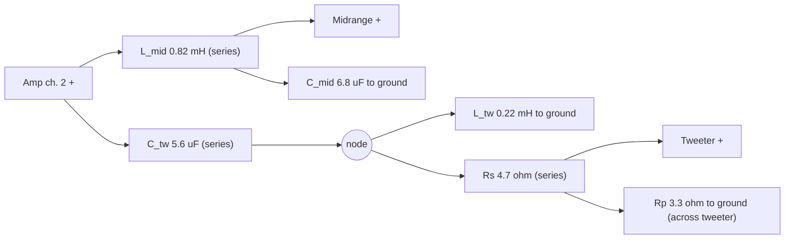

# Lab day: build the crossover and measure System D (Task 3)

> **What to change and what we aim for:** `TUNING.md` (Out 1 -5.8 dB, Rp 3.3 -> 8.2 ohm, the flat target, then tuning by ear).

> **After 10-Nov:** results in `results_2026-11-10/LabDay_Results.pdf`, log in `LOG_2026-11-10.md`.
> **For the next session (Thu 12-Nov) use the kit:** in MATLAB `cd lab-day/kit`, then **`labgui`** (buttons, a graph
> and a verdict after every measurement; `labgui('demo')` to rehearse without hardware). Details: `kit/README.md`.

## Which folder is what

One rule: **a folder's top level holds only what you open, run or edit; everything that is only
called by other scripts is in its `core/` subfolder** (and the offline tests in `tests/`).

| Folder | Open / run | Edit | Don't touch |
|---|---|---|---|
| `kit/` | `labgui` (GUI), `lab_run.m` (section by section), `lab` (commands) | `lab_setup.m`, `lab_plan.m` | `core/`, `tests/` |
| `manual/` | Tuesday's `project_run.m`, `zinf_run.m` | `project_dims.m` | `core/`, `tests/` |
| `analysis/` | after the lab: `results_labday`, `pad_predict`, `import_labday`, `labday_to_kit` | | |
| `data/` | `data/<date>/` = one kit/GUI day; `project_*.mat`, `zinf_*.mat` = Tuesday-script runs | | the files (never edited, only added) |
| `model/`, `model_curves.py` | expected curves (`python3 model_curves.py`) | | |

Three ways to measure, all saving data the GUI and the dashboard show: (a) `kit/labgui`,
(b) `kit/lab_run.m` or the `lab` commands, (c) Tuesday's `manual/project_run.m` and `manual/zinf_run.m`
(the GUI's *Load manual runs...* shows those runs too).

> The printed guide (`guide/LabDay_Guide.pdf`) and the plan below were written for 10-Nov and are kept as
> history: where they say `matlab/`, read `manual/`; where they mute a channel in the MiniDSP or pull a
> cable or lift a lead, the chamber's **switchboard** (woofer / mid / tweeter ON/OFF) is what is used;
> and Out 1 is **-5.8 dB**, not -4.5 (10-Nov: 0 dB in tries 1-2, then -5.8 dB balanced the channels).


**Printable guide:** `guide/LabDay_Guide.pdf` walks through the whole day step by step (timeline,
wiring diagrams, what to run and what the output should say). This README is the same plan as a checklist.

Everything needed for the two project-lab sessions on **Tue 10-Nov-2026** (Group 10, booked in the
"Loudspeaker project lab schedule"): what to set, what to build, what to measure, and what the
result should look like. The design itself is `../design/design.json` (unchanged).

| When | Station | What | Script |
|---|---|---|---|
| 13:00-15:00 | Anechoic chamber | build the board, set the MiniDSP, measure the system (vents plugged) | `manual/project_run.m` |
| 15:00-17:00 | Zi/Nfield (Lab D setup) | impedance of the board and the woofer box, near field at the final tuning | `manual/zinf_run.m` |
| Tue 17-Nov 13:00 | IEC listening room | listening test (Task 4) | |

There is **no separate lab description** for these sessions: the instructions are the Project
Guide, Task 3 (pages 4-5: MiniDSP and passive board) plus the Lab D and Lab E descriptions for the
two stations, and Vicente's short briefing on the new equipment (book him for 13:00).

```
lab-day/
  README.md                 this checklist
  guide/LabDay_Guide.pdf    the printable 10-Nov guide (source LabDay_Guide.tex + fig_*.tex; old paths: matlab/ = manual/)
  model_curves.py           predictions for every switch state (vent plugged) -> model/
  model/expected_on.csv     model p/V, 0 deg, per state (re/im)   + expected_on.png
  model/expected_off30.csv  same at 30 deg                         + expected_off30.png
  model/expected_zi.csv     model impedance at the board input (Zmid, Ztw, Zboth) + expected_zi.png
  kit/                      THE WAY FOR 12-NOV: labgui, lab_run.m, lab (see kit/README.md)
  manual/project_run.m      Tuesday's chamber runs, one section each
  manual/zinf_run.m         Tuesday's Zi/Nfield session, one section per measurement
  manual/project_dims.m     fill in by hand on the day (stored in every data file)
  manual/core/              measure_project, compare_project, plot_project, measure_zinf, compare_zinf, zinf_calc
  manual/tests/             test_project, test_zinf: offline, no hardware, must print PASS
  analysis/                 results_labday, pad_predict, import_labday, labday_to_kit (after the lab)
  data/                     project_<tag>.mat, zinf_<tag>.mat (Tuesday scripts), <date>/ (kit / GUI days)
  demo_data/                labgui('demo') only, not in git
```

`measure_project` calls the Lab E course routine `meas_mag_spec2_SoundCard_LabE` (from
`Lab E/matlab/course/` in this repo, or the lab PC's own copy if it is already on the path).
Copy the whole labs repo to the lab PC so the relative paths work. If the routine stops with
"beeps.wav not found" or "no Umik", `cd` into the course folder (or copy `Beeps.wav` next to
`project_run.m`), and start MATLAB only after the UMIK is plugged in. (The kit and the GUI now
do the `cd` themselves when `beeps.wav` sits next to the routine.)

## 1. Bring

- **First project session in the lab?** Vicente asked (announcement 27-Oct) to be booked for a
  short briefing on the new equipment (MiniDSP, filter panels) the first time a group uses it.

- Laptop with the repo pulled, USB stick (the lab PCs have no internet).
- Printed or on screen: this file, `model/expected_on.png`, the board table below.
- Tape measure, multimeter (coil resistance), an LCR meter if the lab has one (ask).
- The vent plugs stay with the box; check both vents are plugged before measuring.

## 2. MiniDSP (Output 1 = woofer, Output 2 = midrange + tweeter)

Step by step in `report/Project_report.tex`, section "Setting up the MiniDSP". In short:

| Setting | Value |
|---|---|
| Routing | only Input 1 -> Output 1 and Input 1 -> Output 2 |
| PEQ, Comp, FIR | bypassed on both outputs, only **Xover** active |
| Output 1 Xover, Advanced | paste `../data/dsp/MiniDSP_woofer_out1.txt` (LR4 low-pass 325 Hz = two identical BW2 biquads), Process |
| Output 2 Xover, Advanced | paste `../data/dsp/MiniDSP_midtw_out2.txt` (LR4 high-pass 325 Hz), Process |
| Gain | Output 1 **-4.5 dB** by design; in the chamber **-5.8 dB** balanced the lab amplifier (10-Nov; tries 1-2 ran at 0 dB by mistake). Output 2 0 dB |
| Invert / polarity | off on both |
| Delay | **0 on both.** The "d = -1.15 m" in the report is only the distance correction used to draw the phase plots, not a delay to type in. |
| Sample rate | the coefficients only hold at **96 kHz**; check the plugin says 96 kHz |

Copy the text from the `.txt` file, not from the PDF (hidden characters). The a1/a2 signs are
the MiniDSP's own convention (a1 = +1.9699), as `DigitalCrossover.m` prints them.

Electrical check with a 325 Hz sine and the scope: Output 1 = input -11.8 dB (-6 dB filter,
-5.8 dB gain), Output 2 = input -6.0 dB, the two in phase (LR4). **Output 2 at -12 dB means the
high-pass is applied twice** (what happened on 12-Nov: see `results_2026-11-12/RESULTS.md`). Save the configuration (slot and
file) so the listening test and the demo on 3 Dec start from the same settings.

## 3. Passive board (amplifier channel 2)

All values are in Appendix 1 of the guide and come from the **course baskets** (guide 3.2): no
combining parts. Both drivers red to +. Keep the two coils apart and at right angles.



| Part | Value | Where | Check the basket part |
|---|---|---|---|
| L_mid | 0.82 mH | series, amp + -> midrange + | carries up to ~1.9 A rms at 10 W |
| C_mid | 6.8 uF | across the midrange | **non-polarised** (film or bipolar), >= 25 V |
| C_tw | 5.6 uF | series, amp + -> node | non-polarised, >= 25 V |
| L_tw | 0.22 mH | node -> ground | |
| Rs | 4.7 ohm | node -> tweeter + | **>= 5 W** (13 W worst case with a 10 W sine in the tweeter band; music far less) |
| Rp | 3.3 ohm | across the tweeter | >= 5 W (2.8 W worst case) |

All parts from the course baskets (Project Guide 3.2, Appendix 1 Table 1): at least two of each
value, no combining parts, return unused parts.

Measure each part with the LCR meter if there is one, and each coil's resistance with the
multimeter, and write the numbers into `manual/project_dims.m`. Expected effects (model): coil
resistance 0.3 / 0.6 / 1.0 ohm per mH lowers the sum by at most 0.23 / 0.45 / 0.74 dB; 400 random
boards (coils 5 %, caps 10 %, resistors 5 %) stay inside a 1.7 dB band (report, Tolerances).
Amplifier channel 2 never sees less than 4.4 ohm.

## 4. Measurement plan (anechoic chamber, vents plugged)

Same placement as Lab E if possible (mic 2.44 m, 1.15 m high, mid/tweeter box at the Lab E spot):
the model is the Lab E data, so the closer the placement, the better the comparison. The chamber
is not valid below 125 Hz; the low end is Task 1's job (near field, already done in Lab D).

One run = up to three states with ~30 s of beeps in between (the course routine's `Nmeas <= 3`).
States inside one run are phase-coherent; separate runs are not (the UMIK has its own USB clock).
The states are selected on the chamber's **switchboard** (woofer, midrange, tweeter each ON/OFF, as in Lab E),
not with the MiniDSP mute, not by pulling amplifier cables and not by lifting leads at the board.

| Run | Angle | States (switch during the beeps) | What it proves |
|---|---|---|---|
| R1 | 0 | woofer (switchboard W) -> mid+tw (M+T) -> all (W+M+T) | each channel against the model; channel balance; woofer + mid/tw = all |
| R2 | 0 | mid (switchboard M) -> tw (T) -> all (W+M+T) | the passive board, driver by driver |
| R3 | 0 | all -> woofer inverted (Out 1 invert) -> tweeter swapped (at the board) | phase alignment: model says notch at **329 Hz, -21 dB** and **3.9 kHz, -14 dB** |
| R4 | 30 | woofer -> mid+tw -> all | off-axis, against the Lab E 30 deg model |
| R5 | 0 | repeat of R1 | drift/placement: 'all' must land on R1's within a few tenths of a dB |

After R3: untick the invert and swap the tweeter back. Do not touch the amplifier volume or the
microphone between runs. `project_run.m` holds these as sections.

**What "good" looks like** (printed by `compare_project` after every run):
- level offset per state: any value is fine (MiniDSP and amplifier volume), but **woofer and
  mid+tw within about 1 dB of each other**. If not, the two amplifier channels differ: correct it
  with the Output 1 gain and note the new value.
- shape error (1/6 octave, after the offset) about 1-2 dB or less.
- sum check |woofer + mid/tw| vs |all| under ~0.5 dB.
- the two polarity notches clearly visible near the predicted frequencies.
- expected on-axis sum: 4.0 dB spread 150 Hz-15 kHz (vent plugged), 6.3 dB at 30 deg.

## 4b. Zi/Nfield session (15-17, Lab D setup)

The NI card drives the amplifier directly through the series resistor, as in Lab D: no MiniDSP
in this chain. `measure_zinf` uses the Lab D course routine (`../../../Lab D/matlab/course/`).

| Run | Setup | Expected | Why |
|---|---|---|---|
| Z1 `board` | amp -> R -> board input, both drivers on | \|Z\| min 4.4 ohm at ~5.9 kHz, ~6.4 ohm at 50 Hz | the load amp ch. 2 really sees; checks the build |
| Z2 `board_mid` | tweeter lead off | model Zmid (min 4.8 ohm at ~200 Hz) | mid branch alone |
| Z3 `board_tw` | midrange lead off | model Ztw | tweeter branch alone |
| Z4 `woofer_L160` | one vent open at 160 mm, other plugged, filling in | fb ~23.4 Hz (Lab D), model 24.6 | the box is as designed |
| NF1/NF2 | near field cone / vent mouth, resistor shorted | on top of Lab D's L = 160 mm curves | low end for the report (the chamber stops at 125 Hz) |
| X (optional) | both vents open | | never measured; quiz 1 only estimated it |

Gotchas from Lab D, now handled in code: `R` is **required** and must be the multimeter value of
the series resistor (32.9 ohm), never R_E; when AI0 sits on a DC offset (the bridged amplifier
output), `zinf_calc` switches to V_amp = 2*AI0 and says so; samples on the +-10 V rail are
flagged. Also measure both vents' inner diameters and the telescope range (`project_dims`).

## 5. Lessons from Labs B and D, applied

- Use the wrapper (`measure_project`), never the bare course routine: it keeps the raw spectra,
  time signals, states, `project_dims` and a copy of the pasted MiniDSP text in every file.
- Reference before **and** after: R5 repeats R1.
- Write down every dimension, the UMIK serial (read the label), the temperature, the amp volume.
- The Lab D 'R' / AI0 half-voltage problem does not apply here (no series resistor; the reference
  is the sound card line-out looped to line-in), **but confirm with the TA that the reference is
  still tapped before the MiniDSP** in the upgraded setup. If it is tapped after the MiniDSP or the
  amplifier, the measured p/V is not the system response and the plan needs changing.

## 6. Before leaving

Save the MiniDSP config, photograph the board (report todo), copy `data/` to the USB stick, delete
our files from the lab PC, return unused parts and banana cables to the baskets.
