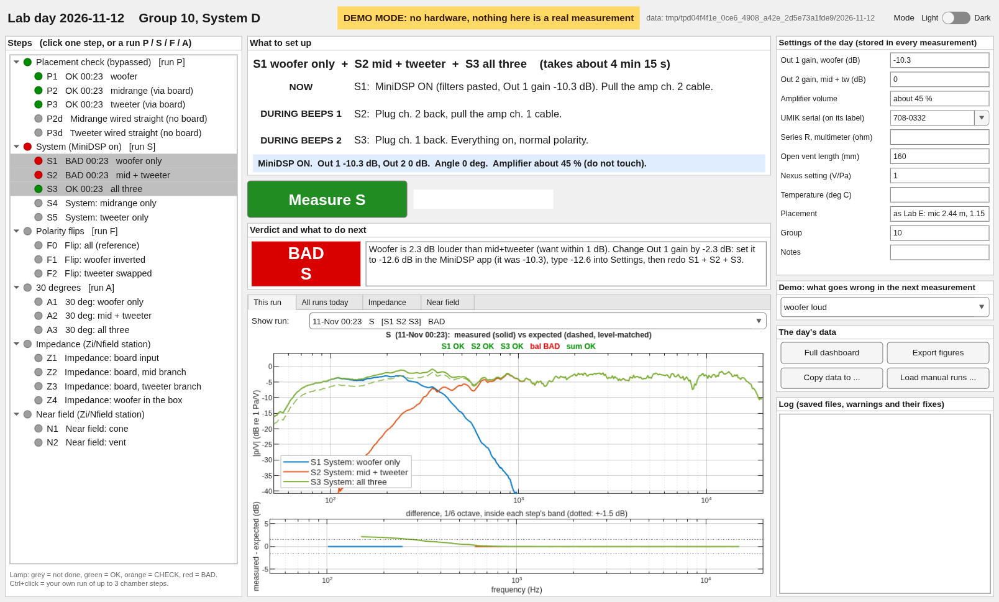

# Lab kit: the lab day in one window (or one command)

**Open / run:** `labgui.m` (the GUI: type `labgui`; at home `labgui demo`), `lab_run.m` (the same
steps as Run Section), `lab.m` (the same as a command: `lab P`, `lab S`, ...).
**Edit:** `lab_setup.m` (the day's settings: also editable in the GUI), `lab_plan.m` (the steps, one line each).
**Don't touch:** `core/` (everything that is only called) and `tests/` (`test_lab`, `test_labgui`: must print PASS).
Data go to `../data/<date>/` (real) or `../demo_data/<date>/` (demo), never overwritten.
All folders are found through `core/labpaths.m`.

## The GUI: `labgui`

In MATLAB: `cd` into this folder and type `labgui`. Rehearsal without hardware: `labgui demo`.



- **Left, Steps.** Every step with a lamp (grey not done, green OK, orange CHECK, red BAD) and the
  time it was measured. Click one step, or a run heading (P, S, F, A) to measure its three steps
  in one go. Ctrl+click picks up to three chamber steps of your own (e.g. S4 + S5 + S3).
- **Middle, top: What to set up.** What to do NOW, what to switch during beeps 1 and beeps 2,
  MiniDSP bypass/on, the gains, the angle. Then the big **Measure** button. While it measures the
  button is off, a bar shows elapsed / expected time, and the instruction that applies right now
  is highlighted ("BEEPS 1: SWITCH NOW").
- **Middle, bottom: verdict and plots.** OK / CHECK / BAD in colour and, when it is not OK, what
  to do in plain words ("change Out 1 gain by -2.3 dB: set it to -12.6 dB ..."). Tabs: *This run*
  (measured vs expected, level-matched, difference underneath; earlier runs in the "Show run"
  list), *All runs today* (every "all" curve overlaid), *Impedance*, *Near field*.
- **Right.** *Settings of the day* (stored in every measurement and in
  `../data/<date>/settings.json`, so they survive a restart). Buttons: full dashboard, export the
  figures (PNG, always light), copy the day to a folder (USB), load runs made with the Run Section
  scripts (`../data/project_*.mat`, `zinf_*.mat`: only read, never changed). *Log*: saved files and
  warnings (clipping, small UMIK signal, AI0 DC offset) with their fixes; also written to
  `../data/<date>/labgui_log.txt`.
- **Light / Dark** switch top right (remembered).
- If the course routine fails (no UMIK, `beeps.wav` not found, no NI card) the window stays up and
  says what to do. Nothing is saved from a failed measurement.

`labgui demo` adds a list "what goes wrong in the next measurement" (woofer loud, placement, not
switched, quiet, clipping, DC offset, no UMIK, no beeps) so every message can be seen at home.
In demo, "woofer loud" really responds to the Out 1 setting: follow the advice and the run turns OK.

## The command: `lab`

```
lab                 dashboard of everything measured today + the step list
lab P               placement check: woofer, mid, tweeter (MiniDSP BYPASSED) vs Lab E, one run
lab P1              one step on its own
lab S               the system: woofer / mid+tw / all in one run (balance + sum check)
lab S4, lab S5      midrange only, tweeter only (MiniDSP on)
lab F               polarity flips (all / woofer inverted / tweeter swapped)
lab A               30 deg: woofer / mid+tw / all
lab Z1 ... Z4       impedance at the Zi station (board, mid branch, tweeter branch, woofer)
lab N1, lab N2      near field cone / vent
lab list            the step list, with what is done
```

A box says what to set up; press **Measure**. Afterwards the data are in `../data/<date>/<step>.mat`
(repeats get `_2`, `_3`), and the dashboard opens on **Latest** with the verdict in the title. The
dashboard tabs are saved as `../data/<date>/figures/<tab>.png`. `lab` uses `lab_setup.m` plus
whatever was changed in the GUI's Settings that day (it prints which).

What "OK" means: shape within 1.5 dB rms of the expectation in the step's band; woofer vs
mid+tw within 1 dB (else it says how much to change the Out 1 gain); sum check within 0.5 dB;
flip notches at least 10 dB deep near the predicted frequency; board impedance within 1 dB of
the model; woofer fb within 1.5 Hz of Lab D; near field within 1 dB of Lab D over 80 % of 10-200 Hz.

## Files

| File | What |
|---|---|
| `labgui.m` | the GUI |
| `lab_run.m` | Run Section file: one section per step, with what to set up |
| `lab.m` | the command |
| `lab_setup.m` | **edit at the start** (or in the GUI): Out 1 gain, amplifier, vent, series R, UMIK |
| `lab_plan.m` | every step: one line each (add a step = add a line; the GUI picks it up) |
| `core/lab_measure.m` | one run: course routine (or demo stand-in), save, warnings. Used by GUI and command |
| `core/lab_check.m`, `lab_judge.m`, `lab_advice.m` | the verdicts, and what to do next in plain words |
| `core/lab_view.m`, `lab_palette.m` | the GUI's plots and its colours (light / dark) |
| `core/lab_dash.m` | the dashboard figure, always redrawn from the files of the day |
| `core/lab_model.m` | the expected curves (`../model/*.csv`, Lab D data) |
| `core/lab_demo.m` | demo stand-in for the two course routines |
| `core/lab_convert.m` | a `project_*.mat` / `zinf_*.mat` run -> kit format, in memory |
| `core/lab_fix.m` | error of a course routine -> what happened and the fix |
| `core/labpaths.m` | every folder, in one place |
| `tests/test_lab.m`, `tests/test_labgui.m` | offline tests: must print PASS. Screenshots: `tests/screenshots/` |

The expected curves come from `../model_curves.py` (Lab E/D data through our filters, vent plugged).
`byp_*` = MiniDSP bypassed, through the board; `dir_*` = the unit wired straight to the amplifier,
which is exactly the Lab E measurement. The 10-Nov runs are converted into this format in
`../data/2026-11-10/` (`../analysis/labday_to_kit.m`); `labgui('datadir', '../data/2026-11-10')`
or `lab_dash('../data/2026-11-10')` shows that day.
