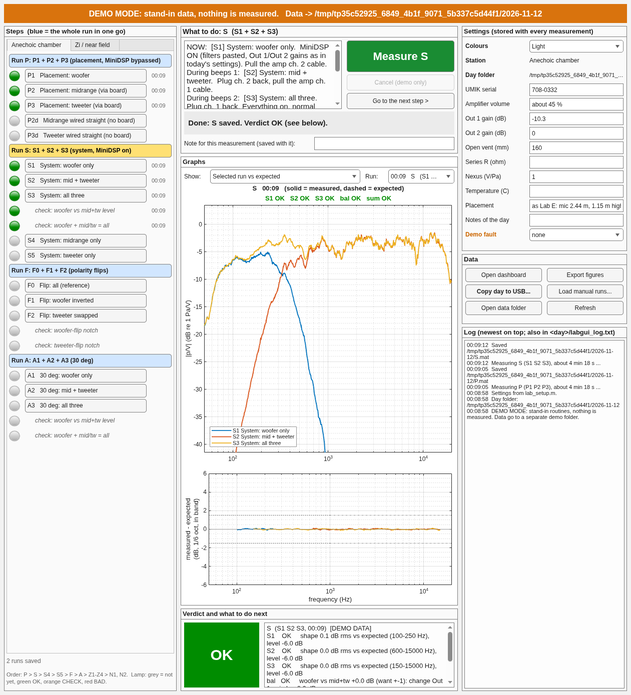

# Lab kit: a graph and a verdict after every measurement

Made after 10-Nov, where the section scripts were hard to follow. In MATLAB on the lab PC,
`cd` into this folder (`lab-day/kit`). **Plug the UMIK in before starting MATLAB.**

| Open / run these | Edit these | Don't touch |
|---|---|---|
| `labgui` (the GUI), `lab_run.m` (section by section), `lab` (commands) | `lab_setup.m` (settings of the day), `lab_plan.m` (one line per step) | `core/` (called automatically), `tests/` |

## Three ways to measure (all save data the GUI and the dashboard can show)

### (a) The GUI: `labgui`

```
labgui              real measurements: data -> lab-day/data/<today>/
labgui('demo')      rehearsal without hardware: stand-in data -> lab-day/demo_data/<today>/ (not in git)
```



More: `screenshots/gui_during_beeps.png` (the orange "switch now" line), `screenshots/gui_dark_run_S.png` (dark mode), `screenshots/gui_error_noUMIK.png` (a failure and its fix). `tests/test_labgui` writes 22 more to `tests/screenshots/` (not in git).

- **Left:** every step with a lamp: grey = not measured, green OK, orange CHECK, red BAD, and the
  time it was measured. Blue buttons measure a **whole run** in one go (P1-P3, S1-S3, F0-F2,
  A1-A3: switch during the beeps). Two tabs: *Anechoic chamber* and *Zi / near field*. The check
  rows (balance, sum, flip notches) have their own lamps.
- **Centre top, "What to do":** what to set up NOW, what to switch during beeps 1 and 2, MiniDSP
  bypassed/on with the Out 1/Out 2 gains, the angle, and a timeline with clock times. The big
  **Measure** button. Under it the status line: while measuring it says which state is being
  measured and turns **orange with "BEEPS 1 - SWITCH NOW to ..."** during the beeps.
  A note field: saved with the next measurement.
- **Centre, "Graphs":** measured (solid) vs expected (dashed, shifted by the fitted level), the
  difference underneath. *Show:* every "all" run of the day (drift), the phase woofer vs mid/tw,
  board impedance Z1-Z3, woofer Z4, near field. *Run:* any earlier run of the day.
- **Centre bottom, "Verdict":** OK / CHECK / BAD in colour, every check in words, and **DO:**
  lines when something is off (e.g. "change the MiniDSP Out 1 gain by -2.3 dB (from -10.3 to
  -12.6 dB)", "the placement differs from Lab E: ... then redo P"), and the next step of the plan.
- **Right:** the settings of the day (Out 1/Out 2 gain, vent, series R, UMIK, temperature, ...):
  type a value and it is saved at once to `data/<today>/session.json` (a restart keeps it, and
  the `lab` commands use it too) and stored in every measurement file. **Colours: Light / Dark.**
  Buttons: *Open dashboard*, *Export figures* (dashboard tabs as PNG, always light),
  *Copy day to USB...* (never overwrites: a second copy gets `_2`), *Load manual runs...*
  (runs made with Tuesday's scripts, see (c)), *Open data folder*, *Refresh*. The log (newest on
  top) is also written to `data/<today>/labgui_log.txt`.
- **When something fails** (no UMIK, `beeps.wav` missing, no NI card, series R not set) the GUI
  stays open, nothing is saved, and the verdict box says what to do. The chamber routine is run
  from its own folder when `beeps.wav` is not in the current one (the 10-Nov problem).
- The course routine blocks MATLAB while it measures, so **Cancel only works in demo mode**; to
  stop a real measurement press Ctrl+C in the Command Window (nothing is saved).
- **Demo mode** (`labgui('demo')`): the same flow with stand-ins for the course routines (the
  expected curves, level -6 dB, random latency, a little noise; a 4-minute run takes 10 s). The
  MiniDSP gains act like the real knobs (Out 1 = -10.3 dB is balanced). The *Demo fault* menu
  rehearses problems: placement off, a state not switched in time, no UMIK, beeps.wav missing,
  clipping, no NI card. Demo data never go into `data/`.

### (b) Commands, or `lab_run.m` in the editor

```
lab                 dashboard of everything measured today + the step list
lab P               placement check: woofer, mid, tweeter (MiniDSP BYPASSED) vs Lab E, one run
lab P1              one step on its own
lab S               the system: woofer / mid+tw / all in one run (balance + sum check)
lab S4, lab S5      midrange only, tweeter only (MiniDSP on)
lab F               polarity flips (all / woofer inverted / tweeter swapped)
lab A               30 deg: woofer / mid+tw / all
lab Z1 ... Z4       impedance at the Zi station (board, mid branch, tweeter branch, woofer)
lab N1, lab N2      near field cone / vent
lab list            the step list, with what is done
```

`lab_run.m` has one section per step with these commands and what to set up: open it in the
editor and click *Run Section*, like `project_run.m` on Tuesday. Before every measurement a box
says what to set up; press **Measure**. Afterwards the verdict and DO lines are printed and the
dashboard opens on **Latest**.

### (c) Tuesday's scripts: `../manual/project_run.m`, `../manual/zinf_run.m`

Still work unchanged (section by section, data in `lab-day/data/project_*.mat`, `zinf_*.mat`).
To see those runs in the GUI with lamps and verdicts: *Load manual runs...* (copies them into
the day folder as `manual_<tag>.mat`; the originals are only read).

## What "OK" means

Shape within 1.5 dB rms of the expectation in the step's band; woofer vs mid+tw within 1 dB
(else it says how much to change the Out 1 gain); sum check within 0.5 dB; flip notches at least
10 dB deep near the predicted frequency; board impedance within 1 dB of the model; woofer fb
within 1.5 Hz of Lab D; near field within 1 dB of Lab D over 80 % of 10-200 Hz.
Signal checks: near full scale (clipping) = BAD, a very small UMIK signal or the AI0 DC offset = CHECK.

## Files

| File | What |
|---|---|
| `labgui.m` | the GUI |
| `lab_run.m` | the same, section by section in the editor |
| `lab.m` | the commands |
| `lab_setup.m` | **edit at the start** (or use the GUI's settings): Out 1 gain (-10.3 dB on 10-Nov), amplifier, vent (160 mm), series R, UMIK |
| `lab_plan.m` | every step, one line each (add a step = add a line) |
| `core/` | `lab_measure` (calls the course routine, saves; no plots), `lab_check` (verdicts), `lab_advice` (DO lines), `lab_plot` + `lab_dash` (graphs, dashboard), `lab_model` (expected curves), `lab_settings` (session.json), `lab_import` (manual runs), `lab_demo` (stand-ins), `gui_palette` (light/dark colours), `labpaths` (every folder, in one place) |
| `tests/` | `test_lab` (the commands) and `test_labgui` (the GUI in demo mode; screenshots in `tests/screenshots/`): both must print PASS |

The expected curves come from `../model_curves.py` (Lab E/D data through our filters, vent plugged).
`byp_*` = MiniDSP bypassed, through the board; `dir_*` = the unit wired straight to the amplifier,
which is exactly the Lab E measurement. The 10-Nov runs are in this format in
`../data/2026-11-10/` (`../analysis/labday_to_kit.m`): `labgui('datadir', '../data/2026-11-10')`
or `lab_dash('../data/2026-11-10')` shows that day.

Tested on MATLAB R2026a (offline, demo mode). Written for older versions too (R2021a features;
newer ones such as the figure Theme are only tried); not yet run on the lab PC itself.
